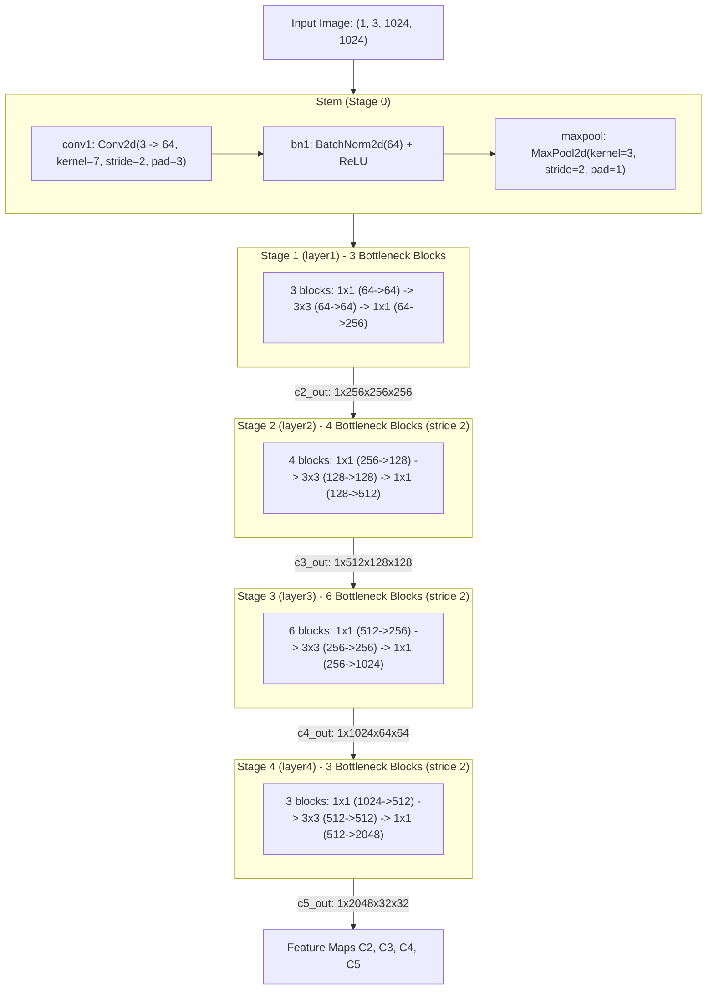

# CFA Model Structure

This document details the internal architecture, code components, and backbone parameters for the CFA (Convex-hull Feature Adaptation) model.

______________________________________________________________________

## 1. Model Configuration and ONNX Export

Target configuration: [`configs/cfa/cfa_r50_fpn_40e_dota_oc.py`](../../configs/cfa/cfa_r50_fpn_40e_dota_oc.py).

### ONNX Generation Command

```bash
python tools/analysis_tools/dump_model_structure.py \
    configs/cfa/cfa_r50_fpn_40e_dota_oc.py \
    --out-dir model_structure_analysis/cfa_r50_fpn_40e_dota_oc \
    --shape 1024 1024
```

This command generates the following decoupled `.onnx` files:
- `backbone_resnet.onnx`
- `neck.onnx`
- `backbone_neck.onnx`
- `dense_head.onnx`

______________________________________________________________________

## 2. Code Components

| Component Name | What is used here | Code Link |
| :--- | :--- | :--- |
| **Detector** | `RotatedRepPoints`: Single-stage detector wrapper handling end-to-end model execution (`__init__: L10-L18`). | [rotated_reppoints.py: L7-L18](../../mmrotate/models/detectors/rotated_reppoints.py#L7-L18) |
| **Base Detector** | `RotatedSingleStageDetector`: Base class implementing feature extraction (`extract_feat: L39-L44`), training (`forward_train: L55-L83`), and test (`simple_test: L85-L108`). | [single_stage.py: L10-L139](../../mmrotate/models/detectors/single_stage.py#L10-L139) |
| **Backbone Builder** | `build_backbone`: Instantiates 4-stage `ResNet-50` returning feature maps $C_2..C_5$ (invoked by detector at `single_stage.py: L30`). | [builder.py: L15-L17](../../mmrotate/models/builder.py#L15-L17) |
| **Neck Builder** | `build_neck`: Instantiates `FPN` using lateral 1×1 convs and top-down additions (invoked by detector at `single_stage.py: L32`). | [builder.py: L20-L22](../../mmrotate/models/builder.py#L20-L22) |
| **Dense Head** | `RotatedRepPointsHead`: Anchor-free dense head predicting non-rigid points, class scores, and oriented boxes. | [rotated_reppoints_head.py: L20-L1194](../../mmrotate/models/dense_heads/rotated_reppoints_head.py#L20-L1194) |
| **Initial Points Offset** | `reppoints_pts_init_conv` + `reppoints_pts_init_out`: Defines initial 9-point regression layers (executed in `forward_single: L236-L239`). | [rotated_reppoints_head.py: L185-L189](../../mmrotate/models/dense_heads/rotated_reppoints_head.py#L185-L189) |
| **Deformable Feature Adaptation (Cls)** | `reppoints_cls_conv` + `reppoints_cls_out`: `DeformConv2d` layer sampling features at predicted points for orientation-aware classification (executed in `forward_single: L246-L248`). | [rotated_reppoints_head.py: L191-L196](../../mmrotate/models/dense_heads/rotated_reppoints_head.py#L191-L196) |
| **Deformable Feature Adaptation (Pts)** | `reppoints_pts_refine_conv` + `reppoints_pts_refine_out`: `DeformConv2d` layer refining point locations using deformable receptive fields (executed in `forward_single: L250-L253`). | [rotated_reppoints_head.py: L198-L203](../../mmrotate/models/dense_heads/rotated_reppoints_head.py#L198-L203) |
| **Points to Rotated BBox** | `points2rotrect`: Converts 9 point coordinates to minimum area bounding rectangles via `min_area_polygons()`. | [rotated_reppoints_head.py: L205-L217](../../mmrotate/models/dense_heads/rotated_reppoints_head.py#L205-L217) |
| **CFA Reassignment Algorithm** | `reassign`: Convex-hull set adaptation, dynamic top-k candidate pool selection, and gradient consistency splitting. | [rotated_reppoints_head.py: L864-L1027](../../mmrotate/models/dense_heads/rotated_reppoints_head.py#L864-L1027) |
| **Convex IoU Assigner** | `MaxConvexIoUAssigner`: Assigns ground truth boxes to convex hull point sets based on Convex-IoU metric (`assign: L54-L202`). | [max_convex_iou_assigner.py: L11-L219](../../mmrotate/core/bbox/assigners/max_convex_iou_assigner.py#L11-L219) |
| **Convex-GIoU Loss** | `ConvexGIoULoss`: Continuous differentiable convex-hull intersection over union loss function (`forward: L88-L115`). | [convex_giou_loss.py: L68-L115](../../mmrotate/models/losses/convex_giou_loss.py#L68-L115) |
| **Rotated NMS** | `multiclass_nms_rotated`: Filters overlapping rotated bounding boxes across pyramid levels (invoked in dense head at `rotated_reppoints_head.py: L1188-L1191`). | [bbox_nms_rotated.py: L6-L94](../../mmrotate/core/post_processing/bbox_nms_rotated.py#L6-L94) |

______________________________________________________________________

## 3. ResNet-50 Backbone Breakdown

In OpenMMLab, the **ResNet** backbone is built dynamically at runtime by `build_backbone(cfg)` according to the parameters specified in `model.backbone`:

- **`depth=50`**: Selects the block type and stage depth from `arch_settings` $\to$ `(Bottleneck, (3, 4, 6, 3))`.
- **`num_stages=4`**: Constructs 4 sequential stages (`layer1` through `layer4`) via `make_res_layer()`.
- **`out_indices=(0, 1, 2, 3)`**: Extracts feature maps after each stage to output pyramid levels $(C_2, C_3, C_4, C_5)$.
- **`frozen_stages=1`**: Freezes gradients and sets evaluation mode for the stem (`conv1`, `bn1`) and Stage 1 (`layer1`).
- **`norm_cfg=dict(type=norm_type, requires_grad=True)`**: Dynamically constructs normalization layers (`BN` or `SyncBN`).
- **`style='pytorch'`**: Employs stride=2 in the $3 \times 3$ convolution of downsampling blocks (standard PyTorch style).



### Layer and Parameter Specifications

| Stage | Name | Input Resolution | Output Channels | Stride | Structure | Parameters |
| :--- | :--- | :--- | :--- | :--- | :--- | :--- |
| **Stem** | `conv1`, `bn1` | $1024 \times 1024$ | 64 | 4 | $7 \times 7$ Conv, MaxPool | ~9.5K (9,536) |
| **Stage 1** | `layer1` | $256 \times 256$ | 256 ($C_2$) | 4 | 3 Bottleneck blocks $[64, 64, 256]$ | ~0.22M (215,808) |
| **Stage 2** | `layer2` | $128 \times 128$ | 512 ($C_3$) | 8 | 4 Bottleneck blocks $[128, 128, 512]$ | ~1.22M (1,219,584) |
| **Stage 3** | `layer3` | $64 \times 64$ | 1024 ($C_4$) | 16 | 6 Bottleneck blocks $[256, 256, 1024]$ | ~7.10M (7,098,368) |
| **Stage 4** | `layer4` | $32 \times 32$ | 2048 ($C_5$) | 32 | 3 Bottleneck blocks $[512, 512, 2048]$ | ~14.96M (14,964,736) |
| **Total** | | | | | **50 Conv layers** | **23,508,032 (~23.51M)** |
