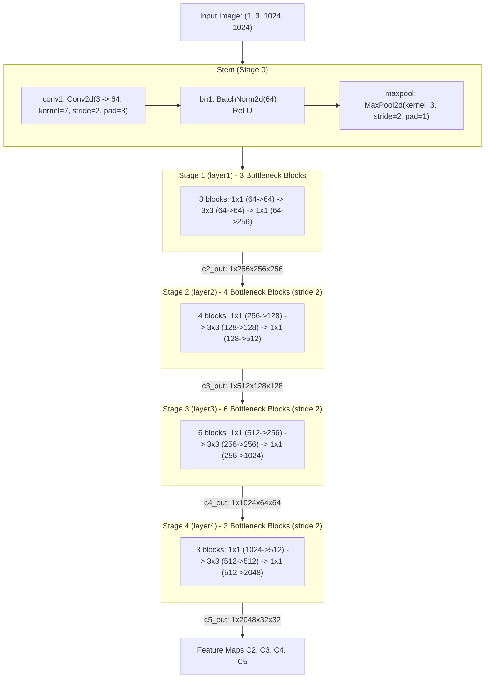

# CFA Model Structure

This document details the internal architecture, configuration parameters, and code components for the CFA (Convex-hull Feature Adaptation) model. 

The structure and parameters are analyzed based on the target configuration [`configs/cfa/cfa_r50_fpn_40e_dota_oc.py`](../../configs/cfa/cfa_r50_fpn_40e_dota_oc.py) (which inherits base architecture settings from [`configs/rotated_reppoints/rotated_reppoints_r50_fpn_1x_dota_oc.py`](../../configs/rotated_reppoints/rotated_reppoints_r50_fpn_1x_dota_oc.py)).

______________________________________________________________________

## 1. ONNX Model Export

### ONNX Generation Command

```bash
python tools/analysis_tools/dump_model_structure.py \
    configs/cfa/cfa_r50_fpn_40e_dota_oc.py \
    --out-dir model_structure/cfa_r50_fpn_40e_dota_oc \
    --shape 1024 1024
```

This command generates the following decoupled `.onnx` files:
- `backbone_resnet.onnx`
- `neck.onnx`
- `backbone_neck.onnx`
- `dense_head.onnx`

______________________________________________________________________

## 2. Configuration Parameters Breakdown

### 2.1. Backbone (`ResNet-50`)

Configuration parameters in [`configs/rotated_reppoints/rotated_reppoints_r50_fpn_1x_dota_oc.py` (lines 15–25)](../../configs/rotated_reppoints/rotated_reppoints_r50_fpn_1x_dota_oc.py#L15-L25):

```python
    backbone=dict(
        type='ResNet',
        depth=50,       # Network depth (from {18, 34, 50, 101, 152})
        num_stages=4,   # Stages of the network (layer1-layer4)
        out_indices=(0, 1, 2, 3),  # Stages from which feature maps are returned
        frozen_stages=1,           # Stages to be frozen (stop grad and set eval mode)
        zero_init_residual=False,  # Whether to zero-init last norm layer in resblocks to act as identity
        norm_cfg=dict(type=norm_type, requires_grad=True),  # Config dict for norm layers
        norm_eval=True,            # Freeze running stats (mean and var) in norm layers
        style='pytorch',           # Stride-two layer is the 3x3 conv layer
        init_cfg=dict(type='Pretrained', checkpoint='torchvision://resnet50')),  # Initialization config dict
```

The backbone generates 4 multi-scale feature maps (`out_indices=(0, 1, 2, 3)`):
* $C_2$: stride 4, 256 channels ($H/4 \times W/4$, resolution $256 \times 256$ for $1024 \times 1024$ input);
* $C_3$: stride 8, 512 channels ($H/8 \times W/8$, resolution $128 \times 128$);
* $C_4$: stride 16, 1024 channels ($H/16 \times W/16$, resolution $64 \times 64$);
* $C_5$: stride 32, 2048 channels ($H/32 \times W/32$, resolution $32 \times 32$).

### 2.2. Neck (`FPN`)

Configuration parameters in [`configs/rotated_reppoints/rotated_reppoints_r50_fpn_1x_dota_oc.py` (lines 26–33)](../../configs/rotated_reppoints/rotated_reppoints_r50_fpn_1x_dota_oc.py#L26-L33):

```python
    neck=dict(
        type='FPN',
        in_channels=[256, 512, 1024, 2048],  # Number of input channels per scale
        out_channels=256,                    # Number of output channels (used at each scale)
        start_level=1,                       # Index of start input backbone level used to build feature pyramid
        add_extra_convs='on_input',          # Add conv layers on top of the last feature map of neck inputs
        num_outs=5,                          # Number of output scales
        norm_cfg=norm_cfg),                  # Config dict for normalization layer
```

The FPN constructs 5 multi-scale feature pyramid levels (`num_outs=5`, starting from $C_3$ via `start_level=1`):
* $P_3$ (from $C_3$): stride 8, 256 channels ($128 \times 128$, small objects, e.g. small vehicles);
* $P_4$ (from $C_4$): stride 16, 256 channels ($64 \times 64$, medium objects, e.g. ships, swimming pools);
* $P_5$ (from $C_5$): stride 32, 256 channels ($32 \times 32$, large objects, e.g. airplanes, bridges);
* $P_6$ (extra stride-2 conv over $C_5$): stride 64, 256 channels ($16 \times 16$, extra-large objects);
* $P_7$ (extra stride-2 conv over $P_6$): stride 128, 256 channels ($8 \times 8$, giant objects / hangars / fields).

### 2.3. Head / Detector (`RotatedRepPoints` & `RotatedRepPointsHead`)

Configuration parameters in [`configs/rotated_reppoints/rotated_reppoints_r50_fpn_1x_dota_oc.py` (lines 14, 34–57)](../../configs/rotated_reppoints/rotated_reppoints_r50_fpn_1x_dota_oc.py#L34-L57):

```python
model = dict(
    type='RotatedRepPoints',  # Implementation of Rotated RepPoints
    ...
    bbox_head=dict(
        type='RotatedRepPointsHead',  # Rotated RepPoints head
        num_classes=15,               # Number of classes
        in_channels=256,              # Number of input channels
        feat_channels=256,            # Number of feature channels
        point_feat_channels=256,      # Number of channels of points features
        stacked_convs=3,              # Number of stacked convolutions
        num_points=9,                 # Number of points in points set
        gradient_mul=0.3,             # Multiplier to gradients from points refinement and recognition
        point_strides=[8, 16, 32, 64, 128],  # Points strides
        point_base_scale=2,           # Bbox scale for assigning labels
        norm_cfg=norm_cfg,            # Config dict for normalization
        loss_cls=dict(
            type='FocalLoss',
            use_sigmoid=True,
            gamma=2.0,
            alpha=0.25,
            loss_weight=1.0),         # Config of classification loss
        loss_bbox_init=dict(type='ConvexGIoULoss', loss_weight=0.375),  # Config of initial points loss
        loss_bbox_refine=dict(type='ConvexGIoULoss', loss_weight=1.0),  # Config of points loss in refinement
        transform_method='rotrect',   # Method to transform RepPoints to bbox
        use_reassign=False,           # Whether to reassign samples
        topk=6,                       # Number of the highest topk points
        anti_factor=0.75),            # Feature anti-aliasing coefficient
```

CFA override in [`configs/cfa/cfa_r50_fpn_1x_dota_oc.py` (lines 3–9)](../../configs/cfa/cfa_r50_fpn_1x_dota_oc.py#L3-L9):
```python
model = dict(
    # Enable CFA (Convex-hull Feature Adaptation)
    bbox_head=dict(
        use_reassign=True),           # Whether to reassign samples (enabled for CFA)
    train_cfg=dict(
        refine=dict(
            # Lower IoU threshold to collect a candidate pool for reassign
            assigner=dict(
                pos_iou_thr=0.1,      # IoU threshold for positive bboxes
                neg_iou_thr=0.1))))   # IoU threshold for negative bboxes
```

______________________________________________________________________

## 3. Code Components

| Component Name | What is used here | Code Link |
| :--- | :--- | :--- |
| **Detector** | `RotatedRepPoints`: Single-stage detector wrapper handling end-to-end model execution. | [rotated_reppoints.py: L7-L18](../../mmrotate/models/detectors/rotated_reppoints.py#L7-L18) |
| **Base Detector** | `RotatedSingleStageDetector`: Base class implementing feature extraction (`extract_feat: L39-L44`), training (`forward_train: L55-L83`), and test (`simple_test: L85-L108`). | [single_stage.py](../../mmrotate/models/detectors/single_stage.py) |
| **Backbone Builder** | `build_backbone`: Instantiates 4-stage `ResNet-50` returning feature maps $C_2..C_5$ (invoked by detector at `single_stage.py: L30`). | [builder.py: L15-L17](../../mmrotate/models/builder.py#L15-L17) |
| **Neck Builder** | `build_neck`: Instantiates `FPN` using lateral 1×1 convs and top-down additions (invoked by detector at `single_stage.py: L32`). | [builder.py: L20-L22](../../mmrotate/models/builder.py#L20-L22) |
| **Dense Head** | `RotatedRepPointsHead`: Anchor-free dense head predicting non-rigid points, class scores, and oriented boxes. | [rotated_reppoints_head.py: L20-L1194](../../mmrotate/models/dense_heads/rotated_reppoints_head.py#L20-L1194) |
| **Initial Points Offset** | `reppoints_pts_init_conv` + `reppoints_pts_init_out`: Defines initial 9-point regression layers (executed in `forward_single: L236-L239`). | [rotated_reppoints_head.py: L185-L189](../../mmrotate/models/dense_heads/rotated_reppoints_head.py#L185-L189) |
| **Deformable Feature Adaptation (Cls)** | `reppoints_cls_conv` + `reppoints_cls_out`: `DeformConv2d` layer sampling features at predicted points for orientation-aware classification (executed in `forward_single: L246-L248`). | [rotated_reppoints_head.py: L191-L196](../../mmrotate/models/dense_heads/rotated_reppoints_head.py#L191-L196) |
| **Deformable Feature Adaptation (Pts)** | `reppoints_pts_refine_conv` + `reppoints_pts_refine_out`: `DeformConv2d` layer refining point locations using deformable receptive fields (executed in `forward_single: L250-L253`). | [rotated_reppoints_head.py: L198-L203](../../mmrotate/models/dense_heads/rotated_reppoints_head.py#L198-L203) |
| **Points to Rotated BBox** | `points2rotrect`: Converts 9 point coordinates to minimum area bounding rectangles via `min_area_polygons()`. | [rotated_reppoints_head.py: L205-L217](../../mmrotate/models/dense_heads/rotated_reppoints_head.py#L205-L217) |
| **CFA Reassignment Algorithm** | `reassign`: Convex-hull set adaptation, dynamic top-k candidate pool selection, and gradient consistency splitting. | [rotated_reppoints_head.py: L864-L1027](../../mmrotate/models/dense_heads/rotated_reppoints_head.py#L864-L1027) |
| **Convex IoU Assigner** | `MaxConvexIoUAssigner`: Assigns ground truth boxes to convex hull point sets based on Convex-IoU metric (`assign: L54-L202`). | [max_convex_iou_assigner.py: L11-L219](../../mmrotate/core/bbox/assigners/max_convex_iou_assigner.py#L11-L219) |
| **Convex-GIoU Loss** | `ConvexGIoULoss`: Continuous differentiable convex-hull intersection over union loss function (`forward: L88-L115`). | [convex_giou_loss.py: L68-L115](../../mmrotate/models/losses/convex_giou_loss.py#L68-L115) |
| **Rotated NMS** | `multiclass_nms_rotated`: Filters overlapping rotated bounding boxes across pyramid levels (invoked in dense head at `rotated_reppoints_head.py: L1188-L1191`). | [bbox_nms_rotated.py: L6-L94](../../mmrotate/core/post_processing/bbox_nms_rotated.py#L6-L94) |

______________________________________________________________________

## 4. ResNet-50 Backbone Breakdown

In OpenMMLab, the **ResNet** backbone is built dynamically at runtime by `build_backbone(cfg)` according to the parameters specified in `model.backbone`:

- **`depth=50`**: Selects the block type and stage depth from `arch_settings` $\to$ `(Bottleneck, (3, 4, 6, 3))`.
- **`num_stages=4`**: Constructs 4 sequential stages (`layer1` through `layer4`) via `make_res_layer()`.
- **`out_indices=(0, 1, 2, 3)`**: Extracts feature maps after each stage to output pyramid levels $(C_2, C_3, C_4, C_5)$.
- **`frozen_stages=1`**: Freezes gradients and sets evaluation mode for the stem (`conv1`, `bn1`) and Stage 1 (`layer1`).
- **`norm_cfg=dict(type=norm_type, requires_grad=True)`**: Dynamically constructs normalization layers (`BN` or `SyncBN`).
- **`style='pytorch'`**: Employs stride=2 in the $3 \times 3$ convolution of downsampling blocks (standard PyTorch style).



### Layer and Parameter Specifications

| Stage | Name | Input Resolution | Output Channels | Stride | Structure | Parameters |
| :--- | :--- | :--- | :--- | :--- | :--- | :--- |
| **Stem** | `conv1`, `bn1` | $1024 \times 1024$ | 64 | 4 | $7 \times 7$ Conv, MaxPool | ~9.5K (9,536) |
| **Stage 1** | `layer1` | $256 \times 256$ | 256 ($C_2$) | 4 | 3 Bottleneck blocks $[64, 64, 256]$ | ~0.22M (215,808) |
| **Stage 2** | `layer2` | $128 \times 128$ | 512 ($C_3$) | 8 | 4 Bottleneck blocks $[128, 128, 512]$ | ~1.22M (1,219,584) |
| **Stage 3** | `layer3` | $64 \times 64$ | 1024 ($C_4$) | 16 | 6 Bottleneck blocks $[256, 256, 1024]$ | ~7.10M (7,098,368) |
| **Stage 4** | `layer4` | $32 \times 32$ | 2048 ($C_5$) | 32 | 3 Bottleneck blocks $[512, 512, 2048]$ | ~14.96M (14,964,736) |
| **Total** | | | | | **50 Conv layers** | **23,508,032 (~23.51M)** |
