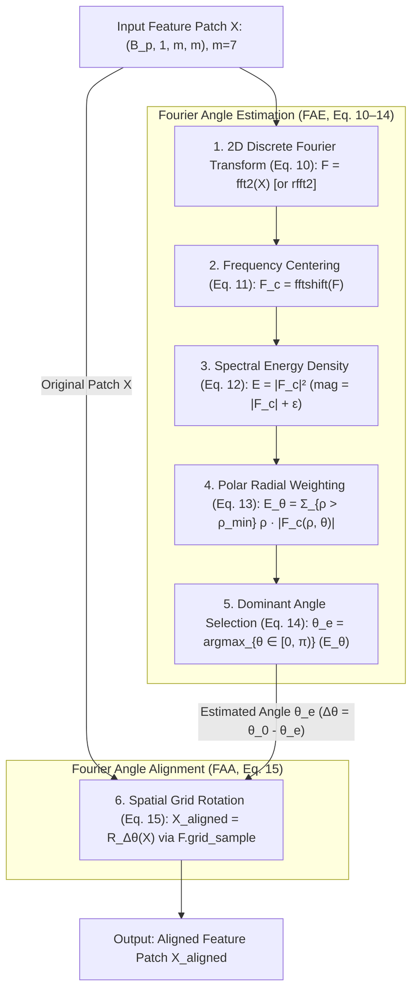
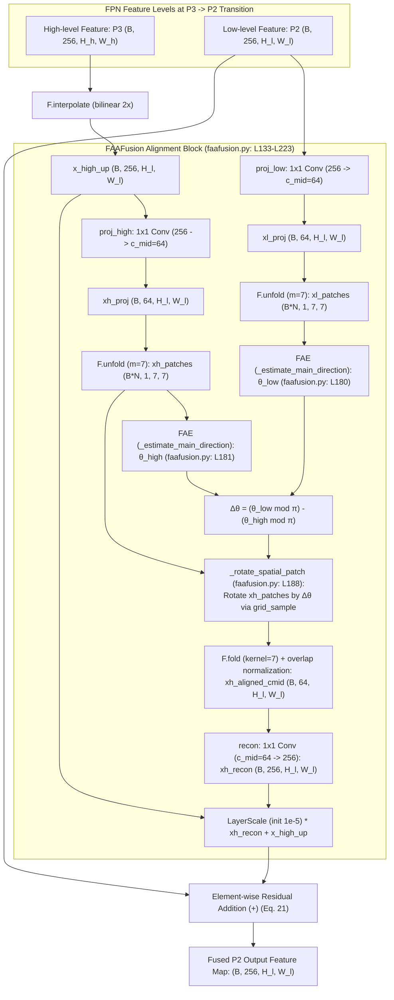
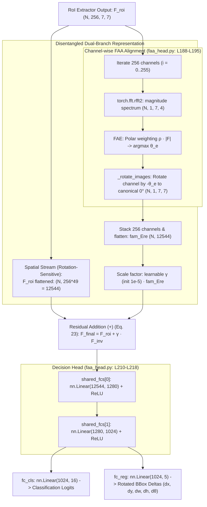

# FAA Model Structure

Target configuration: [`configs/faa/lsk_s_fpn_1x_dota_rr_le90_faa.py`](../../configs/faa/lsk_s_fpn_1x_dota_rr_le90_faa.py).

This document details the internal architecture, code components, backbone parameters, and Fourier Angle Estimation (FAE) module for the FAA (Fourier Angle Alignment) model.

______________________________________________________________________

## 1. ONNX Model Export

```bash
python tools/analysis_tools/dump_model_structure.py \
    configs/faa/lsk_s_fpn_1x_dota_rr_le90_faa.py \
    --out-dir model_structure/lsk_s_fpn_1x_dota_rr_le90_faa \
    --shape 1024 1024
```

This command generates the following decoupled `.onnx` files:
- `backbone_lsknet.onnx`
- `neck.onnx`
- `backbone_neck.onnx`
- `roi_head.onnx`

______________________________________________________________________

## 2. Configuration Parameters Breakdown

### 2.1. Backbone (`LSKNet-S`)

Configuration parameters in [`configs/faa/lsk_s_fpn_1x_dota_rr_le90_faa.py` (lines 16–26)](../../configs/faa/lsk_s_fpn_1x_dota_rr_le90_faa.py#L16-L26):

```python
    backbone=dict(
        type='LSKNet',
        embed_dims=[64, 128, 320, 512],  # Feature channel dimensions for 4 stages (C2-C5)
        drop_rate=0.1,                   # Dropout rate
        drop_path_rate=0.1,              # Stochastic depth decay rate across blocks
        depths=[2, 2, 4, 2],             # Number of sequential LSK blocks per stage (total 10 blocks)
        init_cfg=dict(
            type='Pretrained',
            checkpoint='data/pretrained/lsk_s_backbone.pth.tar'),  # Pretrained weights checkpoint
        norm_cfg=dict(type=norm_type, requires_grad=True)          # Normalization layer config (SyncBN/BN)
    ),
```

The backbone generates 4 multi-scale feature maps:
* $C_2$: stride 4, 64 channels ($H/4 \times W/4$, resolution $256 \times 256$ for $1024 \times 1024$ input);
* $C_3$: stride 8, 128 channels ($H/8 \times W/8$, resolution $128 \times 128$);
* $C_4$: stride 16, 320 channels ($H/16 \times W/16$, resolution $64 \times 64$);
* $C_5$: stride 32, 512 channels ($H/32 \times W/32$, resolution $32 \times 32$).

### 2.2. Neck (`FAAFusionFPN`)

Configuration parameters in [`configs/faa/lsk_s_fpn_1x_dota_rr_le90_faa.py` (lines 27–37)](../../configs/faa/lsk_s_fpn_1x_dota_rr_le90_faa.py#L27-L37):

```python
    neck=dict(
        type='FAAFusionFPN',
        in_channels=[64, 128, 320, 512],  # Input channels per scale from backbone stages C2-C5
        out_channels=256,                 # Output channels for all pyramid levels
        num_outs=5,                       # Number of output scales (P2, P3, P4, P5, P6)
        fusion_modes=['add', 'add',
                      'faa'],             # P5->P4: add, P4->P3: add, P3->P2: faa (alignment)
        start_level=0,                    # Start input level (0 -> C2)
        end_level=-1,                     # End input level (-1 -> C5)
        add_extra_convs='on_input',       # Extra conv on C5 to generate P6
        fam_cfg=dict(m=7, c_mid=64)),     # FAA config: patch size m=7, projection channels c_mid=64
```

The neck builds 5 output feature levels:
* $P_2$: stride 4, 256 channels ($256 \times 256$), top-down fused with $P_3$ using Fourier Angle Alignment (`'faa'`);
* $P_3$: stride 8, 256 channels ($128 \times 128$), top-down fused with $P_4$ via element-wise addition (`'add'`);
* $P_4$: stride 16, 256 channels ($64 \times 64$), top-down fused with $P_5$ via element-wise addition (`'add'`);
* $P_5$: stride 32, 256 channels ($32 \times 32$), lateral projection from $C_5$;
* $P_6$: stride 64, 256 channels ($16 \times 16$), downsampled from $C_5$ via $3 \times 3$ conv (stride 2, `add_extra_convs='on_input'`).

### 2.3. RPN & RoI Head / Detector (`OrientedRCNN`, `OrientedRPNHead` & `FAAHead`)

Configuration parameters in [`configs/faa/lsk_s_fpn_1x_dota_rr_le90_faa.py` (lines 38–85)](../../configs/faa/lsk_s_fpn_1x_dota_rr_le90_faa.py#L38-L85):

```python
    rpn_head=dict(
        type='OrientedRPNHead',
        in_channels=256,                  # Input channels from FPN (P2-P6)
        feat_channels=256,                # Intermediate feature channels
        version=angle_version,            # Angle representation ('le90')
        anchor_generator=dict(
            type='AnchorGenerator',
            scales=[8],                   # Base anchor scale
            ratios=[0.5, 1.0, 2.0],       # Aspect ratios
            strides=[4, 8, 16, 32, 64]),  # Feature map strides corresponding to P2-P6
        bbox_coder=dict(
            type='MidpointOffsetCoder',   # Midpoint offset parameterization (x, y, w, h, alpha, beta)
            angle_range=angle_version,
            target_means=[0.0, 0.0, 0.0, 0.0, 0.0, 0.0],
            target_stds=[1.0, 1.0, 1.0, 1.0, 0.5, 0.5]),
        loss_cls=dict(
            type='CrossEntropyLoss', use_sigmoid=True, loss_weight=1.0),
        loss_bbox=dict(
            type='SmoothL1Loss', beta=0.1111111111111111, loss_weight=1.0)),
    roi_head=dict(
        type='OrientedStandardRoIHead',
        bbox_roi_extractor=dict(
            type='RotatedSingleRoIExtractor',
            roi_layer=dict(
                type='RoIAlignRotated',
                out_size=7,               # Output RoI feature spatial resolution (7x7)
                sample_num=2,             # Number of sampling points
                clockwise=True),
            out_channels=256,             # Output channels
            featmap_strides=[4, 8, 16, 32]),  # Strides of pyramid levels used for RoI extraction (P2-P5)
        bbox_head=dict(
            type='FAAHead',
            in_channels=256,              # Input channels from RoI extractor
            fc_out_channels=1024,         # Fully-connected feature dimension
            roi_feat_size=7,              # Spatial size of RoI features
            num_classes=15,               # Number of foreground object classes in DOTA
            bbox_coder=dict(
                type='DeltaXYWHAOBBoxCoder',  # Oriented bounding box delta coder (dx, dy, dw, dh, dtheta)
                angle_range=angle_version,
                norm_factor=None,
                edge_swap=True,
                proj_xy=True,
                target_means=(.0, .0, .0, .0, .0),
                target_stds=(0.1, 0.1, 0.2, 0.2, 0.1)),
            reg_class_agnostic=True,      # Shared bbox regressor across classes
            loss_cls=dict(
                type='CrossEntropyLoss', use_sigmoid=False, loss_weight=1.0),
            loss_bbox=dict(type='SmoothL1Loss', beta=1.0, loss_weight=1.0))),
```

______________________________________________________________________

## 3. Code Components

### 3.1. Backbone (`LSKNet-S`)

| Component Name | Role & Implementation | Code Link |
| :--- | :--- | :--- |
| **Backbone** | `LSKNet`: Large Selective Kernel Network with dynamic receptive fields. | [lsknet.py](../../mmrotate/models/backbones/lsknet.py) |
| **Backbone Builder** | `build_backbone`: Instantiates LSKNet via `ROTATED_BACKBONES` registry. | [builder.py: L15-L17](../../mmrotate/models/builder.py#L15-L17) (invoked at [two_stage.py: L32](../../mmrotate/models/detectors/two_stage.py#L32)) |

### 3.2. Neck (`FAAFusionFPN`)

| Component Name | Role & Implementation | Code Link |
| :--- | :--- | :--- |
| **Neck (FAAFusionFPN)** | `FAAFusionFPN`: Multi-scale pyramid with frequency-aware feature fusion on stage transitions. | [faafusion.py](../../mmrotate/models/necks/faafusion.py) |
| **Neck Builder** | `build_neck`: Instantiates FAAFusionFPN via `ROTATED_NECKS` registry. | [builder.py: L20-L22](../../mmrotate/models/builder.py#L20-L22) (invoked at [two_stage.py: L35](../../mmrotate/models/detectors/two_stage.py#L35)) |
| **Neck Alignment Block** | `FAAFusion`: Aligns local patch orientations via 2D FFT and rotates high-level features before addition. | [faafusion.py: L15-L223](../../mmrotate/models/necks/faafusion.py#L15-L223) |
| **FAE Direction Estimator** | `_estimate_main_direction`: Computes dominant orientation angle $\theta_e$ from spectral energy density. | [faafusion.py: L82-L103](../../mmrotate/models/necks/faafusion.py#L82-L103) |

### 3.3. RPN & RoI Head / Detector (`OrientedRCNN`, `OrientedRPNHead` & `FAAHead`)

| Component Name | Role & Implementation | Code Link |
| :--- | :--- | :--- |
| **Detector** | `OrientedRCNN`: Top-level two-stage rotated detector wrapper. | [oriented_rcnn.py](../../mmrotate/models/detectors/oriented_rcnn.py) |
| **Base Detector** | `RotatedTwoStageDetector`: Base class managing feature extraction, training, and testing loops. | [two_stage.py](../../mmrotate/models/detectors/two_stage.py) |
| **RPN Head** | `OrientedRPNHead`: Stage 1 dense head producing midpoint-offset oriented proposals from $P_2..P_6$. | [oriented_rpn_head.py](../../mmrotate/models/dense_heads/oriented_rpn_head.py) |
| **RPN Builder** | `build_head`: Instantiates OrientedRPNHead via `ROTATED_HEADS` registry. | [builder.py: L35-L37](../../mmrotate/models/builder.py#L35-L37) (invoked at [two_stage.py: L41](../../mmrotate/models/detectors/two_stage.py#L41)) |
| **Midpoint BBox Coder** | `MidpointOffsetCoder`: Encodes and decodes rotated bounding boxes using midpoint offsets. | [delta_midpointoffset_rbbox_coder.py](../../mmrotate/core/bbox/coder/delta_midpointoffset_rbbox_coder.py) |
| **RoI Head** | `OrientedStandardRoIHead`: Two-stage decision head managing box extractors and classification/regression branches. | [oriented_standard_roi_head.py](../../mmrotate/models/roi_heads/oriented_standard_roi_head.py) |
| **RoI Head Builder** | `build_head`: Instantiates OrientedStandardRoIHead via `ROTATED_HEADS` registry. | [builder.py: L35-L37](../../mmrotate/models/builder.py#L35-L37) (invoked at [two_stage.py: L50](../../mmrotate/models/detectors/two_stage.py#L50)) |
| **RoI Feature Extractor** | `RotatedSingleRoIExtractor`: Resamples rotated regions of interest into fixed $7 \times 7$ patches via `RoIAlignRotated`. | [rotate_single_level_roi_extractor.py](../../mmrotate/models/roi_heads/roi_extractors/rotate_single_level_roi_extractor.py) |
| **Bounding Box Head** | `FAAHead`: Two-layer MLP with residual angle alignment for classification and regression. | [faa_head.py: L144-L218](../../mmrotate/models/roi_heads/faa_head.py#L144-L218) |
| **RoI Alignment Block** | `class FAA`: Rotates RoI feature channels to horizontal $0^\circ$ canonical orientation. | [faa_head.py: L14-L140](../../mmrotate/models/roi_heads/faa_head.py#L14-L140) |
| **Rotated NMS** | `multiclass_nms_rotated`: Suppresses redundant overlapping rotated bounding boxes during inference. | [bbox_nms_rotated.py](../../mmrotate/core/post_processing/bbox_nms_rotated.py) |

______________________________________________________________________

## 4. LSKNet-S Backbone Breakdown

For the detailed configuration parameters of the backbone (`embed_dims`, `depths`, `drop_rate`, etc.), see [Section 2.1](#21-backbone-lsknet-s).

### Layer and Parameter Specifications

| Stage | Sub-modules | Input Resolution | Output Channels | Stride | Forwarded to Neck | Depth (Blocks) | Parameters |
| :--- | :--- | :--- | :--- | :--- | :--- | :--- | :--- |
| **Stage 1** | `patch_embed1`, `block1` | $1024 \times 1024$ | 64 | 4 | **$C_2$** ($256 \times 256$) | 2 blocks | ~0.19M (192,268) |
| **Stage 2** | `patch_embed2`, `block2` | $256 \times 256$ | 128 | 8 | **$C_3$** ($128 \times 128$) | 2 blocks | ~0.76M (758,540) |
| **Stage 3** | `patch_embed3`, `block3` | $128 \times 128$ | 320 | 16 | **$C_4$** ($64 \times 64$) | 4 blocks | ~5.25M (5,249,112) |
| **Stage 4** | `patch_embed4`, `block4` | $64 \times 64$ | 512 | 32 | **$C_5$** ($32 \times 32$) | 2 blocks | ~7.64M (7,640,972) |
| **Total** | | | | | **4 feature maps** | **10 LSK Blocks** | **13,840,892 (~13.84M)** |

The 4 feature maps $(C_2, C_3, C_4, C_5)$ produced by `patch_embed1`–`block4` are forwarded directly to the FAAFusionFPN neck (`in_channels=[64, 128, 320, 512]`).

______________________________________________________________________

## 5. Fourier Angle Estimation (FAE) Module

### 5.1. Code Locations
The FAE algorithm and spatial angle alignment (FAA) correspond strictly to Equations (10)–(15) of the paper and are implemented across two locations:

- **Neck (`FAAFusion` in [`faafusion.py`](../../mmrotate/models/necks/faafusion.py)):**
  - **FAE Angle Estimation (Eq. 10–14):** [`faafusion.py: L82-L103`](../../mmrotate/models/necks/faafusion.py#L82-L103) (`_estimate_main_direction`), invoked on unfolded patches at [`faafusion.py: L180-L181`](../../mmrotate/models/necks/faafusion.py#L180-L181) to compute $\theta_{low}$ and $\theta_{high}$.
  - **FAA Spatial Alignment (Eq. 15):** [`faafusion.py: L105-L131`](../../mmrotate/models/necks/faafusion.py#L105-L131) (`_rotate_spatial_patch`), invoked on high-level patches at [`faafusion.py: L188-L189`](../../mmrotate/models/necks/faafusion.py#L188-L189) to rotate by $\Delta\theta$.
  - **Complete Neck Module:** [`faafusion.py: L15-L223`](../../mmrotate/models/necks/faafusion.py#L15-L223) (`class FAAFusion`).

- **RoI Head (`FAA` / `FAAHead` in [`faa_head.py`](../../mmrotate/models/roi_heads/faa_head.py)):**
  - **FAE Angle Estimation (Eq. 10–14):** [`faa_head.py: L106-L121`](../../mmrotate/models/roi_heads/faa_head.py#L106-L121) (within `FAA.forward`, computing 2D rFFT, polar radial energy weighting, and argmax $\theta_e$).
  - **FAA Canonical $0^\circ$ Alignment (Eq. 15):** [`faa_head.py: L62-L99`](../../mmrotate/models/roi_heads/faa_head.py#L62-L99) (`_rotate_images`), invoked at [`faa_head.py: L135`](../../mmrotate/models/roi_heads/faa_head.py#L135) to rotate channels to canonical horizontal orientation.
  - **Complete RoI Alignment Module:** [`faa_head.py: L14-L140`](../../mmrotate/models/roi_heads/faa_head.py#L14-L140) (`class FAA`), invoked per channel across 256 channels at [`faa_head.py: L188-L195`](../../mmrotate/models/roi_heads/faa_head.py#L188-L195) in `FAAHead`.

### 5.2. Mathematical Algorithm (Paper Equations 10–15)



---

### 5.3. Alignment Applications in the Detector

#### 1. Neck Alignment (`FAAFusionFPN`)
- **Problem addressed:** Coarse downsampled features from higher stages ($P_3$, stride 8) exhibit blurred directional cues, causing destructive interference when simply added to high-resolution low-level features ($P_2$, stride 4).
- **Mechanism:** In the transition $P_3 \to P_2$ (`fusion_modes=['add', 'add', 'faa']`), $7 \times 7$ patches are unfolded from both levels. FAE estimates $\theta_{low}$ and $\theta_{high}$. High-level patches are rotated by $\Delta\theta = (\theta_{low} \bmod \pi) - (\theta_{high} \bmod \pi)$ via bilinear grid sampling, folded back, modulated by learnable `layer_scale`, and fused:
  $$Y_l = X_l + \text{LayerScale}(Y_{recon}^{l+1}) + Y_{up}^{l+1} \quad \text{(Eq. 21)}$$



#### 2. RoI Head Alignment (`FAAHead`)
- **Problem addressed:** Task conflict in shared FC layers between rotation-invariant classification (an object must be recognized irrespective of its angle) and rotation-sensitive bounding box regression (angles and dimensions depend strictly on spatial orientation).
- **Mechanism:** Extracted $7 \times 7$ RoI feature channels (256 channels) are aligned to canonical horizontal $0^\circ$ orientation ($\Delta\theta = -\theta_e$). The resulting rotation-invariant feature ($F_{inv}$) is residually combined with the original rotation-sensitive spatial feature ($F_{roi}$):
  $$F_{final} = F_{roi} + \gamma \cdot F_{inv} \quad \text{(Eq. 23)}$$


