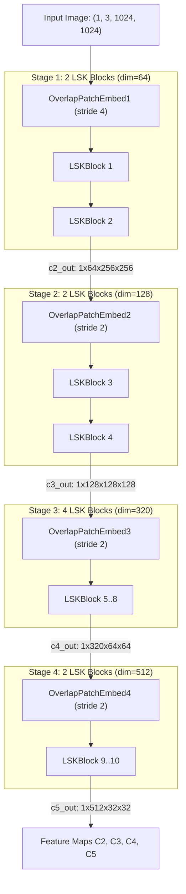
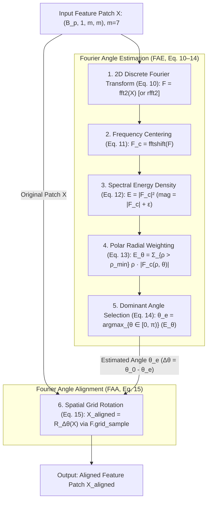
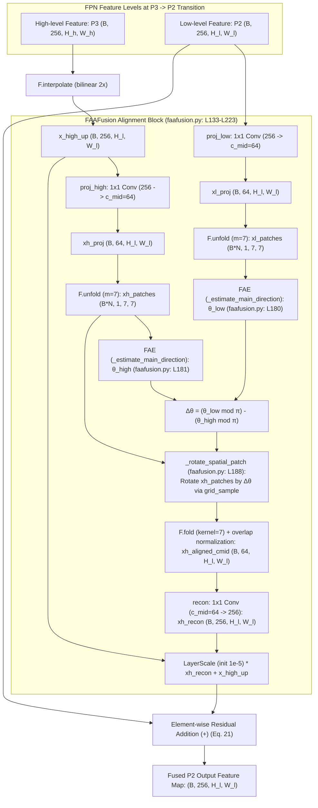
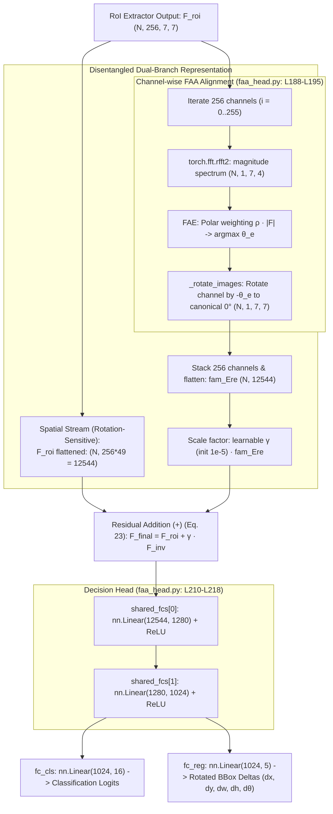

# FAA Model Structure

This document details the internal architecture, code components, backbone parameters, and Fourier Angle Estimation (FAE) module for the FAA (Fourier Angle Alignment) model.

______________________________________________________________________

## 1. Model Configuration and ONNX Export

Target configuration: [`configs/faa/lsk_s_fpn_1x_dota_rr_le90_faa.py`](../../configs/faa/lsk_s_fpn_1x_dota_rr_le90_faa.py).

### ONNX Generation Command

```bash
python tools/analysis_tools/dump_model_structure.py \
    configs/faa/lsk_s_fpn_1x_dota_rr_le90_faa.py \
    --out-dir model_structure_analysis/lsk_s_fpn_1x_dota_rr_le90_faa \
    --shape 1024 1024
```

This command generates the following decoupled `.onnx` files:
- `backbone_lsknet.onnx`
- `neck.onnx`
- `backbone_neck.onnx`
- `roi_head.onnx`

______________________________________________________________________

## 2. Code Components

| Component Name | What is used here | Code Link |
| :--- | :--- | :--- |
| **Detector** | `OrientedRCNN`: Two-stage rotated detector orchestrating backbone, neck, RPN, and RoI head (`__init__: L15-L32`, `forward_dummy: L34-L50`). | [oriented_rcnn.py: L9-L50](../../mmrotate/models/detectors/oriented_rcnn.py#L9-L50) |
| **Base Detector** | `RotatedTwoStageDetector`: Base class implementing feature extraction (`extract_feat: L65-L70`), training (`forward_train: L90-L153`), and test (`simple_test: L173-L184`). | [two_stage.py: L11-L195](../../mmrotate/models/detectors/two_stage.py#L11-L195) |
| **Backbone** | `LSKNet` (Small): Large Selective Kernel Network with dynamic receptive fields (4 stages, depths 2, 2, 4, 2; `forward_features: L257-L272`). | [lsknet.py: L166-L277](../../mmrotate/models/backbones/lsknet.py#L166-L277) |
| **Neck (FPN)** | `FAAFusionFPN`: Multi-scale pyramid with frequency-aware feature fusion on stage transitions (`forward: L324-L366`). | [faafusion.py: L227-L366](../../mmrotate/models/necks/faafusion.py#L227-L366) |
| **Neck Alignment Block** | `FAAFusion`: Aligns local orientations via 2D FFT and rotates high-level features before addition (`forward: L133-L223`). | [faafusion.py: L15-L223](../../mmrotate/models/necks/faafusion.py#L15-L223) |
| **Direction Estimator (FAE)** | Analytical 2D FFT orientation estimator used in both Neck and RoI Head (Paper Eq. 10–14). | [Section 4: FAE Module](#4-fourier-angle-estimation-fae-module) |
| **RPN Head (Stage 1)** | `OrientedRPNHead`: Generates midpoint-offset oriented proposals from FPN levels $P_2..P_6$ (`_init_layers: L22-L33`, `_get_targets_single: L35-L162`). | [oriented_rpn_head.py: L15-L325](../../mmrotate/models/dense_heads/oriented_rpn_head.py#L15-L325) |
| **Midpoint BBox Coder** | `MidpointOffsetCoder`: Encodes and decodes rotated bounding boxes using midpoint offsets (`encode: L35-L52`, `decode: L54-L84`). | [delta_midpointoffset_rbbox_coder.py: L13-L84](../../mmrotate/core/bbox/coder/delta_midpointoffset_rbbox_coder.py#L13-L84) |
| **RoI Feature Extractor** | `RotatedSingleRoIExtractor`: Resamples rotated regions of interest into fixed $7 \times 7$ patches via bilinear interpolation (`forward: L91-L149`). | [rotate_single_level_roi_extractor.py: L14-L167](../../mmrotate/models/roi_heads/roi_extractors/rotate_single_level_roi_extractor.py#L14-L167) |
| **RoI Head (Stage 2)** | `OrientedStandardRoIHead`: Two-stage decision head managing box extractors and classification/regression branches (`simple_test_bboxes: L126-L188`). | [oriented_standard_roi_head.py: L10-L188](../../mmrotate/models/roi_heads/oriented_standard_roi_head.py#L10-L188) |
| **Bounding Box Head** | `FAAHead`: Two-layer MLP with residual angle alignment for classification and regression (`forward: L180-L218`). | [faa_head.py: L144-L218](../../mmrotate/models/roi_heads/faa_head.py#L144-L218) |
| **RoI Alignment Block** | `class FAA`: Rotates RoI feature channels to horizontal $0^\circ$ canonical orientation (`_rotate_images: L62-L99`, `forward: L101-L140`). | [faa_head.py: L14-L140](../../mmrotate/models/roi_heads/faa_head.py#L14-L140) |
| **Rotated NMS** | `multiclass_nms_rotated`: Suppresses redundant overlapping rotated bounding boxes (invoked in RoI box head at `rotated_bbox_head.py: L456-L458`). | [bbox_nms_rotated.py: L6-L94](../../mmrotate/core/post_processing/bbox_nms_rotated.py#L6-L94) |

______________________________________________________________________

## 3. LSKNet-S Backbone Breakdown

In OpenMMLab, the **LSKNet** backbone is built dynamically at runtime by `build_backbone(cfg)` according to the parameters specified in `model.backbone`:

- **`embed_dims=[64, 128, 320, 512]`**: Sets the intermediate feature channel dimension for each of the 4 stages ($C_2, C_3, C_4, C_5$).
- **`depths=[2, 2, 4, 2]`**: Instantiates the number of sequential `Block` modules per stage (total: 10 LSK blocks).
- **`mlp_ratios=[8, 8, 4, 4]`**: Governs the feed-forward channel expansion ratio inside each block's MLP.
- **`drop_rate=0.1, drop_path_rate=0.1`**: Applies stochastic depth decay and dropout regularization across blocks.
- **`norm_cfg=dict(type=norm_type, requires_grad=True)`**: Dynamically constructs normalization layers (`BN` or `SyncBN`).



### Layer and Parameter Specifications

| Stage | Sub-modules | Resolution | Output Channels | Stride | Depth (Blocks) | Parameters |
| :--- | :--- | :--- | :--- | :--- | :--- | :--- |
| **Stage 1** | `patch_embed1`, `block1` | $256 \times 256$ | 64 ($C_2$) | 4 | 2 blocks | ~0.19M (192,268) |
| **Stage 2** | `patch_embed2`, `block2` | $128 \times 128$ | 128 ($C_3$) | 8 | 2 blocks | ~0.76M (758,540) |
| **Stage 3** | `patch_embed3`, `block3` | $64 \times 64$ | 320 ($C_4$) | 16 | 4 blocks | ~5.25M (5,249,112) |
| **Stage 4** | `patch_embed4`, `block4` | $32 \times 32$ | 512 ($C_5$) | 32 | 2 blocks | ~7.64M (7,640,972) |
| **Total** | | | | | **10 LSK Blocks** | **13,840,892 (~13.84M)** |

______________________________________________________________________

## 4. Fourier Angle Estimation (FAE) Module

### 4.1. Code Locations
The FAE algorithm and spatial angle alignment (FAA) correspond strictly to Equations (10)–(15) of the paper and are implemented across two locations:

- **Neck (`FAAFusion` in [`faafusion.py`](../../mmrotate/models/necks/faafusion.py)):**
  - **FAE Angle Estimation (Eq. 10–14):** [`faafusion.py: L82-L103`](../../mmrotate/models/necks/faafusion.py#L82-L103) (`_estimate_main_direction`), invoked on unfolded patches at [`faafusion.py: L180-L181`](../../mmrotate/models/necks/faafusion.py#L180-L181) to compute $\theta_{low}$ and $\theta_{high}$.
  - **FAA Spatial Alignment (Eq. 15):** [`faafusion.py: L105-L131`](../../mmrotate/models/necks/faafusion.py#L105-L131) (`_rotate_spatial_patch`), invoked on high-level patches at [`faafusion.py: L188-L189`](../../mmrotate/models/necks/faafusion.py#L188-L189) to rotate by $\Delta\theta$.
  - **Complete Neck Module:** [`faafusion.py: L15-L223`](../../mmrotate/models/necks/faafusion.py#L15-L223) (`class FAAFusion`).

- **RoI Head (`FAA` / `FAAHead` in [`faa_head.py`](../../mmrotate/models/roi_heads/faa_head.py)):**
  - **FAE Angle Estimation (Eq. 10–14):** [`faa_head.py: L106-L121`](../../mmrotate/models/roi_heads/faa_head.py#L106-L121) (within `FAA.forward`, computing 2D rFFT, polar radial energy weighting, and argmax $\theta_e$).
  - **FAA Canonical $0^\circ$ Alignment (Eq. 15):** [`faa_head.py: L62-L99`](../../mmrotate/models/roi_heads/faa_head.py#L62-L99) (`_rotate_images`), invoked at [`faa_head.py: L135`](../../mmrotate/models/roi_heads/faa_head.py#L135) to rotate channels to canonical horizontal orientation.
  - **Complete RoI Alignment Module:** [`faa_head.py: L14-L140`](../../mmrotate/models/roi_heads/faa_head.py#L14-L140) (`class FAA`), invoked per channel across 256 channels at [`faa_head.py: L188-L195`](../../mmrotate/models/roi_heads/faa_head.py#L188-L195) in `FAAHead`.

### 4.2. Mathematical Algorithm (Paper Equations 10–15)



---

### 4.3. Alignment Applications in the Detector

#### 1. Neck Alignment (`FAAFusionFPN`)
- **Problem addressed:** Coarse downsampled features from higher stages ($P_3$, stride 8) exhibit blurred directional cues, causing destructive interference when simply added to high-resolution low-level features ($P_2$, stride 4).
- **Mechanism:** In the transition $P_3 \to P_2$ (`fusion_modes=['add', 'add', 'faa']`), $7 \times 7$ patches are unfolded from both levels. FAE estimates $\theta_{low}$ and $\theta_{high}$. High-level patches are rotated by $\Delta\theta = (\theta_{low} \bmod \pi) - (\theta_{high} \bmod \pi)$ via bilinear grid sampling, folded back, modulated by learnable `layer_scale`, and fused:
  $$Y_l = X_l + \text{LayerScale}(Y_{recon}^{l+1}) + Y_{up}^{l+1} \quad \text{(Eq. 21)}$$



#### 2. RoI Head Alignment (`FAAHead`)
- **Problem addressed:** Task conflict in shared FC layers between rotation-invariant classification (an object must be recognized irrespective of its angle) and rotation-sensitive bounding box regression (angles and dimensions depend strictly on spatial orientation).
- **Mechanism:** Extracted $7 \times 7$ RoI feature channels (256 channels) are aligned to canonical horizontal $0^\circ$ orientation ($\Delta\theta = -\theta_e$). The resulting rotation-invariant feature ($F_{inv}$) is residually combined with the original rotation-sensitive spatial feature ($F_{roi}$):
  $$F_{final} = F_{roi} + \gamma \cdot F_{inv} \quad \text{(Eq. 23)}$$


